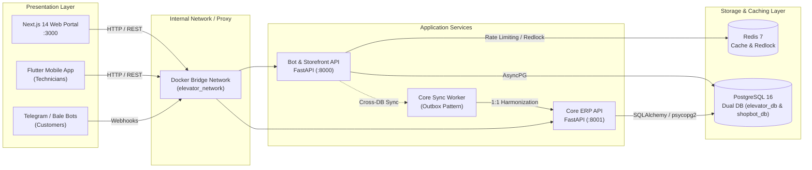

<div align="center">

<a href="https://web-portal-ivory-nine.vercel.app/" target="_blank" rel="noopener noreferrer">
  
</a>

<br/>
<br/>

[](https://web-portal-ivory-nine.vercel.app/)
[](https://web-portal-ivory-nine.vercel.app/)

<p align="center">
  <a href="https://web-portal-ivory-nine.vercel.app/" target="_blank" rel="noopener noreferrer">
    <b>🔗 مشاهده پیش‌نمایش زنده وب‌پورتال (Live Production Preview): https://web-portal-ivory-nine.vercel.app/</b>
  </a>
</p>

</div>

---

# Asanro Elevator Enterprise Ecosystem (Monorepo)
> **Commercial-Grade, Highly Scalable, and Secure Enterprise Architecture for "Asanro Etminan Amir Kerman" (شرکت آسانرو اطمینان امیر کرمان)**

[](https://web-portal-ivory-nine.vercel.app/)
[](https://nextjs.org/)
[](https://flutter.dev/)
[](https://fastapi.tiangolo.com/)
[](https://www.postgresql.org/)
[](https://redis.io/)
[](https://www.docker.com/)
[](https://www.typescriptlang.org/)
[](https://www.python.org/)

---

## 1. Executive Summary & Ecosystem Overview

**Asanro Etminan Amir Kerman** is a licensed elevator engineering and manufacturing enterprise in Kerman province, specializing in high-speed traction, gearless, machine-room-less (MRL), and hydraulic elevator installations, national safety certification, and 24/7 periodic maintenance contracts.

This monorepo unifies the entire digital footprint of the company into an end-to-end, event-driven enterprise ecosystem:

* **Customer Web Portal (`apps/web-portal`)**: Next.js 14 App Router Responsive Progressive Web App (PWA) with zero-CLS fluid hero slider, public parts storefront, interactive consultation workflows, and client/admin management dashboard.
* **Technician & Manager App (`apps/mobile-app`)**: Cross-platform Flutter mobile application used on-site by field technicians for routine elevator inspections, parachute load-testing, task tracking, and building manager check-ins.
* **Operational ERP Core API (`services/core-api`)**: FastAPI backend managing the engineering master data—buildings, elevator specifications, technical inspections, contracts, financial accounting, and emergency dispatch.
* **Storefront & Bot Service (`services/bot-service`)**: High-throughput FastAPI backend powering customer interactions across Telegram and Bale messengers, online shopping carts, payment gateway webhooks, and the Outbox Data Sync engine.
* **Shared Protocols & Data Sync (`shared/` & `services/bot-service/services/core_sync_service.py`)**: Real-time cross-database synchronization ensuring contract requests approved in the web portal are harmonized 1:1 with the Core Elevator App database.



---

## 2. Technology Stack

| Domain | Technology | Key Libraries / Modules |
| :--- | :--- | :--- |
| **Customer Web Portal** | Next.js 14 (App Router), React 18, TypeScript | Tailwind CSS v3/v4, Lucide Icons, Vazirmatn Typography, Zustand, Axios, Standalone Output |
| **Field Mobile Application** | Flutter 3.x, Dart 3.x | BLoC / Provider, Dio, Hive / SQLite (Offline Cache), Camera & Geolocation |
| **Core Operational API** | Python 3.12, FastAPI, Uvicorn | SQLAlchemy 2.0, Alembic, psycopg2-binary, Pydantic v2, python-jose (JWT) |
| **Bot Service & Storefront** | Python 3.12, FastAPI, Asyncpg | SQLAlchemy Async, Redis-py, Redlock, python-telegram-bot, aiohttp |
| **Data Persistence** | PostgreSQL 16 Alpine | Dual Logical Databases (`elevator_db` & `shopbot_db`), Automated Initializer |
| **Caching & Message Broker** | Redis 7 Alpine | Distributed Locking (Redlock), Token Bucket Rate Limiting, Session Management |
| **Containerization & CI/CD** | Docker & Docker Compose v3.8 | Multi-Stage Builds, Non-root `appgroup/nonroot` security, Healthchecks |

---

## 3. Monorepo Directory Architecture

```
Elevator_Ecosystem/
├── apps/
│   ├── web-portal/                  # Next.js 14 Customer Storefront, Contracts & Admin ERP
│   │   ├── src/
│   │   │   ├── app/                 # Next.js App Router Pages (Admin, Dashboard, Products)
│   │   │   ├── components/          # Atomic UI Kit, Section Slides, Header, Footer
│   │   │   ├── lib/                 # Central Axios Client, Authentication & API DTOs
│   │   │   └── store/               # Zustand Global State (Auth, Cart, Navigation)
│   │   ├── public/                  # Static Assets, Compressed Hero Images, Logos
│   │   ├── Dockerfile               # Multi-stage Standalone Node 20-alpine Dockerfile
│   │   ├── .dockerignore            # Excludes node_modules, .next, local logs
│   │   └── next.config.mjs          # Standalone Output & Dynamic Internal API Rewrite
│   └── mobile-app/                  # Flutter Cross-Platform Mobile App (Android/iOS)
│       ├── lib/                     # Feature-driven Architecture (Technician Workflows)
│       └── pubspec.yaml             # Dart & Flutter Dependencies
├── services/
│   ├── core-api/                    # Operational Elevator & Inspection API (FastAPI)
│   │   ├── alembic/                 # Database Migrations for elevator_db
│   │   ├── core/                    # Security, JWT, Database Session & Settings
│   │   ├── modules/                 # Building, Elevator, Contract, Report & Analytics
│   │   ├── main.py                  # FastAPI Entrypoint with CORS & /health Probe
│   │   ├── requirements.txt         # Production Python Dependencies
│   │   ├── Dockerfile               # Multi-stage Hardened Python 3.12-slim Dockerfile
│   │   └── .dockerignore            # Excludes venv, pycache, local uploads
│   └── bot-service/                 # Storefront, Messenger Bots & Outbox Engine (FastAPI)
│       ├── alembic/                 # Database Migrations for shopbot_db
│       ├── api/                     # REST Endpoints (Products, Orders, Contracts, Users)
│       ├── core/                    # Config, Redlock Distributed Locks, Pydantic Settings
│       ├── services/                # Business Logic & core_sync_service.py (Cross-DB Sync)
│       ├── workers/                 # Outbox Processor & Background Jobs
│       ├── main.py                  # Storefront API Entrypoint with /health Probe
│       ├── requirements.txt         # Production Dependencies (asyncpg, redis, etc.)
│       ├── Dockerfile               # Multi-stage Hardened Python 3.12-slim Dockerfile
│       └── .dockerignore            # Excludes venv, pycache, local media
├── infra/
│   ├── docker/
│   │   └── init-multi-postgres.sh   # Bash Init Script for Dual-Database Initialization
│   └── scripts/                     # Operational & Deployment Automation Scripts
├── shared/
│   ├── protos/                      # Protocol Buffers Definitions (gRPC contracts)
│   └── docs/                        # Architectural Specifications & Schemas
├── storage/
│   └── uploads/                     # Centralized Persistent Media Storage
├── docker-compose.yml               # Master Production-Ready Docker Compose Orchestration
├── .env.example                     # Centralized Monorepo Environment Template
├── .env.docker                      # Docker-Ready Production Configuration
└── README.md                        # Enterprise Documentation & Operator Guide
```

---

## 4. Quick Start: Local Development with Docker

The entire ecosystem (PostgreSQL with dual databases, Redis, Core API, Bot Service, and Web Portal) can be launched simultaneously with a single command.

### Prerequisites
* [Docker Desktop](https://www.docker.com/products/docker-desktop/) (Windows / macOS) or `docker-ce` + `docker-compose-plugin` (Linux)
* Git

### Step-by-Step Launch

```powershell
# 1. Clone the repository and navigate to root
git clone <repository_url> Elevator_Ecosystem
cd Elevator_Ecosystem

# 2. Copy the Docker environment template
Copy-Item .env.docker .env   # On Windows PowerShell
# OR: cp .env.docker .env    # On Linux / macOS

# 3. Build and launch all services in detached mode
docker compose up --build -d

# 4. Verify running containers and health checks
docker compose ps
```

### Operational Logs
```powershell
# Stream logs from all services
docker compose logs -f

# Stream logs from a specific component
docker compose logs -f web-portal
docker compose logs -f core-api
docker compose logs -f bot-service
```

### Stopping the Stack
```powershell
# Stop all services gracefully (preserving persistent data in volumes)
docker compose down

# Stop and purge all persistent volumes (Fresh installation)
docker compose down -v
```

---

## 5. Port Mappings & Service Endpoints

| Service | Container Name | Host Port | Internal Port | Protocol | Local & Live Access Points |
| :--- | :--- | :--- | :--- | :--- | :--- |
| **Web Portal (Next.js)** | `elevator_web_portal` | `3000` | `3000` | HTTP | [http://localhost:3000](http://localhost:3000) <br/> **🚀 Live Demo:** [https://web-portal-ivory-nine.vercel.app/](https://web-portal-ivory-nine.vercel.app/) |
| **Bot Service & Storefront** | `elevator_bot_service` | `8000` | `8000` | HTTP | [http://localhost:8000/api/v1/docs](http://localhost:8000/api/v1/docs) |
| **Core Operational API** | `elevator_core_api` | `8001` | `8000` | HTTP | [http://localhost:8001/docs](http://localhost:8001/docs) |
| **PostgreSQL Database** | `elevator_postgres` | `5432` | `5432` | TCP | `localhost:5432` (`elevator_db`, `shopbot_db`) |
| **Redis In-Memory** | `elevator_redis` | `6379` | `6379` | TCP | `localhost:6379` |

---

## 6. Local Development Without Docker (Native)

For active feature engineering, developers can run services independently:

### 1. Database & Cache Infrastructure
```powershell
# Spin up only PostgreSQL and Redis using Docker
docker compose up -d postgres redis
```

### 2. Core API
```powershell
cd services/core-api
python -m venv venv
.\venv\Scripts\Activate.ps1            # Windows
# source venv/bin/activate             # Linux/macOS
pip install -r requirements.txt
alembic upgrade head
uvicorn main:app --reload --port 8001
```

### 3. Bot Service & Storefront Backend
```powershell
cd services/bot-service
python -m venv venv
.\venv\Scripts\Activate.ps1            # Windows
# source venv/bin/activate             # Linux/macOS
pip install -r requirements.txt
alembic upgrade head
uvicorn main:app --reload --port 8000
```

### 4. Next.js Web Portal
```powershell
cd apps/web-portal
npm install
npm run dev
# Portal accessible at http://localhost:3000
```

### 5. Flutter Mobile App
```powershell
cd apps/mobile-app
flutter pub get
flutter run
```

---

## 7. Production Deployment Guide

### Architecture Strategy
* **Frontend (`apps/web-portal`)**: Deploy to [Vercel](https://vercel.com/) (Edge Network CDN) or deploy as a Docker container on a Linux VPS.
* **Backend Services (`services/*`) & Databases**: Deploy via Docker Compose on an Ubuntu 22.04/24.04 LTS VPS with Nginx Reverse Proxy and SSL (Certbot).

---

### Option A: Frontend on Vercel + Backends on Linux VPS

#### 1. Vercel Frontend Configuration
* **Deployed Live Preview:** [https://web-portal-ivory-nine.vercel.app/](https://web-portal-ivory-nine.vercel.app/)
1. Import the Git repository in Vercel.
2. Set **Root Directory** to `apps/web-portal`.
3. Framework Preset: **Next.js**.
4. Configure Environment Variables in Vercel Dashboard:
   ```env
   NEXT_PUBLIC_API_URL=https://api.asanro.com/api/v1
   INTERNAL_API_URL=https://api.asanro.com
   NODE_ENV=production
   ```
5. Deploy. Vercel automatically generates optimized Edge routes and static assets.

#### 2. Linux VPS Setup (Backends & Database)
```bash
# Update server packages
sudo apt update && sudo apt upgrade -y
sudo apt install -y curl git ufw

# Install Docker Engine & Docker Compose Plugin
curl -fsSL https://get.docker.com | sh
sudo usermod -aG docker $USER

# Configure Firewall
sudo ufw default deny incoming
sudo ufw default allow outgoing
sudo ufw allow ssh
sudo ufw allow 80/tcp
sudo ufw allow 443/tcp
sudo ufw enable

# Clone repository on VPS
git clone <repository_url> /opt/elevator-ecosystem
cd /opt/elevator-ecosystem

# Setup production environment
cp .env.docker .env
# Edit .env with strong production passwords & keys:
nano .env

# Run backend services in production mode
docker compose up -d postgres redis core-api bot-service
```

#### 3. Nginx Reverse Proxy & SSL Configuration
Install and configure Nginx on the host VPS:

```nginx
# /etc/nginx/sites-available/asanro-api.conf
server {
    server_name api.asanro.com;

    # Bot & Storefront API (Port 8000)
    location /api/v1/ {
        proxy_pass http://127.0.0.1:8000;
        proxy_set_header Host $host;
        proxy_set_header X-Real-IP $remote_addr;
        proxy_set_header X-Forwarded-For $proxy_add_x_forwarded_for;
        proxy_set_header X-Forwarded-Proto $scheme;
    }

    # Core ERP API (Port 8001)
    location /core/ {
        proxy_pass http://127.0.0.1:8001/;
        proxy_set_header Host $host;
        proxy_set_header X-Real-IP $remote_addr;
        proxy_set_header X-Forwarded-For $proxy_add_x_forwarded_for;
        proxy_set_header X-Forwarded-Proto $scheme;
    }
}
```

Enable SSL using Let's Encrypt Certbot:
```bash
sudo apt install -y certbot python3-certbot-nginx
sudo ln -s /etc/nginx/sites-available/asanro-api.conf /etc/nginx/sites-enabled/
sudo nginx -t
sudo systemctl reload nginx
sudo certbot --nginx -d api.asanro.com
```

---

### Option B: Full Monorepo Containerized on Linux VPS

If hosting both frontend and backends on a single dedicated VPS:

```bash
cd /opt/elevator-ecosystem
cp .env.docker .env
# Start the full stack including web-portal
docker compose up --build -d
```

Configure Nginx to reverse proxy port `3000` for your main domain (`asanro.com`) and port `8000`/`8001` for API subdomains.

---

## 8. Database Migrations & Seed Data

### Applying Migrations
Both services automatically run migrations on container boot. To execute migrations manually:

```powershell
# Core API Migrations (elevator_db)
docker compose exec core-api alembic upgrade head

# Bot Service Migrations (shopbot_db)
docker compose exec bot-service alembic upgrade head
```

### Seeding Initial Data
```powershell
# Seed Core API Admin and Building Categories
docker compose exec core-api python seed_data.py

# Seed Storefront Products and Packages
docker compose exec bot-service python seed_db.py
```

### Database Backups (Cron Job)
Create automated daily backups of both databases:

```bash
#!/bin/bash
# /opt/scripts/backup-databases.sh
BACKUP_DIR="/opt/backups"
TIMESTAMP=$(date +"%Y%m%d_%H%M%S")
mkdir -p $BACKUP_DIR

# Backup elevator_db
docker exec elevator_postgres pg_dump -U postgres elevator_db | gzip > "$BACKUP_DIR/elevator_db_$TIMESTAMP.sql.gz"

# Backup shopbot_db
docker exec elevator_postgres pg_dump -U postgres shopbot_db | gzip > "$BACKUP_DIR/shopbot_db_$TIMESTAMP.sql.gz"

# Retain only last 14 days of backups
find $BACKUP_DIR -type f -name "*.sql.gz" -mtime +14 -delete
```

---

## 9. Security & Hardening Standards

* **Unprivileged Execution:** All containers run with non-root users (`nonroot:appgroup` UID 10001 in Python, `nextjs:nodejs` UID 1001 in Node.js).
* **Network Isolation:** Internal communication happens across a private Docker bridge network (`elevator_net`). Only ports mapped in `docker-compose.yml` are exposed to the host.
* **Token Security:** Short-lived JWT access tokens (HMAC SHA-256) paired with secure HttpOnly cookies.
* **Input Validation & Sanitization:** Strict Pydantic v2 schemas on backends and Zod validation on frontend forms.
* **CORS Whitelisting:** Explicit origin whitelisting in FastAPI configuration preventing unauthorized cross-origin requests.

---

## 10. Authors & Technical Governance

* **Enterprise:** شرکت آسانرو اطمینان امیر کرمان (Asanro Etminan Amir Kerman)
* **Management & Engineering Director:** مهندس محبی (Mohebbi) — `09133982695`
* **Official Registry:** مجری رسمی استاندارد و بیمه آسانسور و پله‌برقی در استان کرمان
* **Architecture:** Enterprise Monorepo Architecture Specification (Antigravity Principal Engineering Standards)

---
*Maintained under standard commercial enterprise licensing. All rights reserved.*
