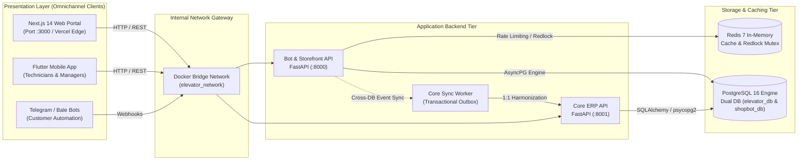
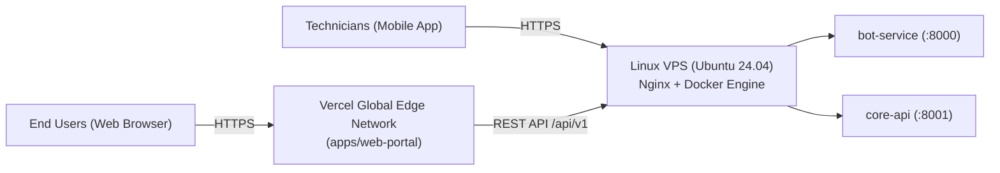

<div align="center">

<a href="https://web-portal-ivory-nine.vercel.app/" target="_blank" rel="noopener noreferrer">
  
</a>

<br/>
<br/>

# 🏢 Asanro Elevator Enterprise Ecosystem
### Commercial-Grade, Event-Driven Monorepo Architecture
**شرکت آسانرو اطمینان امیر کرمان | سیستم یکپارچه مهندسی، سرویس، نگهداری و استاندارد آسانسور**

<br/>

[](https://nextjs.org/)
[](https://fastapi.tiangolo.com/)
[](https://flutter.dev/)
[](https://www.postgresql.org/)
[](https://redis.io/)
[](https://www.docker.com/)
[](https://www.typescriptlang.org/)
[](https://www.python.org/)

<br/>

  <h3><a href="https://web-portal-ivory-nine.vercel.app/">🚀 View Live Production Demo</a></h3>
  <p><i>Access the Customer Web Portal & Storefront</i></p>

<br/>

</div>

---

## 1. Executive Summary & Ecosystem Overview

> ### 📌 Executive Summary
> **Asanro Etminan Amir Kerman** is a licensed elevator engineering and manufacturing enterprise in Kerman province, specializing in high-speed traction, gearless, machine-room-less (MRL), and hydraulic elevator installations, national safety certification, and 24/7 periodic maintenance contracts.
>
> This monorepo consolidates the entire technical operations of the firm into a single, cohesive, high-performance monorepo:
> 
> * **Customer Web Portal (`apps/web-portal`)**: Next.js 14 App Router Progressive Web App (PWA) with zero-CLS fluid hero slider, public parts storefront, interactive consultation workflows, and client/admin management dashboard.
> * **Technician & Manager App (`apps/mobile-app`)**: Cross-platform Flutter mobile application used on-site by field technicians for routine elevator inspections, parachute load-testing, task tracking, and building manager check-ins.
> * **Operational ERP Core API (`services/core-api`)**: FastAPI backend managing the engineering master data—buildings, elevator specifications, technical inspections, contracts, financial accounting, and emergency dispatch.
> * **Storefront & Bot Service (`services/bot-service`)**: High-throughput FastAPI backend powering customer interactions across Telegram and Bale messengers, online shopping carts, payment gateway webhooks, and the Outbox Data Sync engine.
> * **Shared Protocols & Data Sync (`shared/` & `services/bot-service/services/core_sync_service.py`)**: Real-time cross-database synchronization ensuring contract requests approved in the web portal are harmonized 1:1 with the Core Elevator App database.

<br/>



---

## 2. Technology Stack Matrix

| Domain | Technology | Implementation Details & Architectural Purpose |
| :--- | :--- | :--- |
| **Customer Web Portal** | Next.js 14 (App Router), React 18, TypeScript | Tailwind CSS, Lucide Icons, Vazirmatn Typography, Zustand, Axios, Standalone Output |
| **Field Mobile Application** | Flutter 3.x, Dart 3.x | BLoC / Provider Pattern, Dio Client, Hive / SQLite (Offline Cache), Camera & Geolocation |
| **Core Operational API** | Python 3.12, FastAPI, Uvicorn | SQLAlchemy 2.0 ORM, Alembic Migrations, psycopg2-binary, Pydantic v2, python-jose (JWT) |
| **Bot Service & Storefront** | Python 3.12, FastAPI, Asyncpg | Async SQLAlchemy, Redis-py, Redlock Mutex, python-telegram-bot, aiohttp Webhooks |
| **Data Persistence** | PostgreSQL 16 Alpine | Dual Logical Databases (`elevator_db` & `shopbot_db`), Automated Bash Initializer |
| **Caching & Message Broker** | Redis 7 Alpine | Distributed Locking (Redlock), Token Bucket Rate Limiting, Session State Management |
| **Containerization & CI/CD** | Docker & Docker Compose v3.8 | Multi-Stage Builds, Non-root `appgroup/nonroot` security, Automated Healthchecks |

---

## 3. Monorepo Directory Architecture

```
Elevator_Ecosystem/
├── apps/
│   ├── web-portal/                  # Next.js 14 Customer Storefront, Contracts & Admin ERP
│   │   ├── src/
│   │   │   ├── app/                 # Next.js App Router Pages (Admin, Dashboard, Products)
│   │   │   ├── components/          # Atomic UI Kit, Section Slides, Header, Footer
│   │   │   ├── lib/                 # Central Axios Client, Authentication & API DTOs
│   │   │   └── store/               # Zustand Global State (Auth, Cart, Navigation)
│   │   ├── public/                  # Static Assets, Compressed Hero Images, Logos
│   │   ├── Dockerfile               # Multi-stage Standalone Node 20-alpine Dockerfile
│   │   ├── .dockerignore            # Excludes node_modules, .next, local logs
│   │   └── next.config.mjs          # Standalone Output & Dynamic Internal API Rewrite
│   └── mobile-app/                  # Flutter Cross-Platform Mobile App (Android/iOS)
│       ├── lib/                     # Feature-driven Architecture (Technician Workflows)
│       └── pubspec.yaml             # Dart & Flutter Dependencies
├── services/
│   ├── core-api/                    # Operational Elevator & Inspection API (FastAPI)
│   │   ├── alembic/                 # Database Migrations for elevator_db
│   │   ├── core/                    # Security, JWT, Database Session & Settings
│   │   ├── modules/                 # Building, Elevator, Contract, Report & Analytics
│   │   ├── main.py                  # FastAPI Entrypoint with CORS & /health Probe
│   │   ├── requirements.txt         # Production Python Dependencies
│   │   ├── Dockerfile               # Multi-stage Hardened Python 3.12-slim Dockerfile
│   │   └── .dockerignore            # Excludes venv, pycache, local uploads
│   └── bot-service/                 # Storefront, Messenger Bots & Outbox Engine (FastAPI)
│       ├── alembic/                 # Database Migrations for shopbot_db
│       ├── api/                     # REST Endpoints (Products, Orders, Contracts, Users)
│       ├── core/                    # Config, Redlock Distributed Locks, Pydantic Settings
│       ├── services/                # Business Logic & core_sync_service.py (Cross-DB Sync)
│       ├── workers/                 # Outbox Processor & Background Jobs
│       ├── main.py                  # Storefront API Entrypoint with /health Probe
│       ├── requirements.txt         # Production Dependencies (asyncpg, redis, etc.)
│       ├── Dockerfile               # Multi-stage Hardened Python 3.12-slim Dockerfile
│       └── .dockerignore            # Excludes venv, pycache, local media
├── infra/
│   ├── docker/
│   │   └── init-multi-postgres.sh   # Bash Init Script for Dual-Database Initialization
│   └── scripts/                     # Operational & Deployment Automation Scripts
├── shared/
│   ├── protos/                      # Protocol Buffers Definitions (gRPC contracts)
│   └── docs/                        # Architectural Specifications & Schemas
├── storage/
│   └── uploads/                     # Centralized Persistent Media Storage
├── docker-compose.yml               # Master Production-Ready Docker Compose Orchestration
├── .env.example                     # Centralized Monorepo Environment Template
├── .env.docker                      # Docker-Ready Production Configuration
└── README.md                        # Enterprise Documentation & Operator Guide
```

---

## 4. Port Mappings & Service Endpoints

| Service | Container Name | Host Port | Internal Port | Protocol | Local & Live Access Points |
| :--- | :--- | :--- | :--- | :--- | :--- |
| **Web Portal (Next.js)** | `elevator_web_portal` | `3000` | `3000` | HTTP | [http://localhost:3000](http://localhost:3000) <br/> **🚀 Live Demo:** [https://web-portal-ivory-nine.vercel.app/](https://web-portal-ivory-nine.vercel.app/) |
| **Bot Service & Storefront** | `elevator_bot_service` | `8000` | `8000` | HTTP | [http://localhost:8000/api/v1/docs](http://localhost:8000/api/v1/docs) |
| **Core Operational API** | `elevator_core_api` | `8001` | `8000` | HTTP | [http://localhost:8001/docs](http://localhost:8001/docs) |
| **PostgreSQL Database** | `elevator_postgres` | `5432` | `5432` | TCP | `localhost:5432` (`elevator_db`, `shopbot_db`) |
| **Redis In-Memory** | `elevator_redis` | `6379` | `6379` | TCP | `localhost:6379` |

---

## 5. Local Development Quick Start

The entire ecosystem can be bootstrapped locally in seconds using Docker Compose or executed natively for focused feature development.

### Quick Start with Docker Compose
```powershell
# 1. Clone the repository and navigate to root
git clone <repository_url> Elevator_Ecosystem
cd Elevator_Ecosystem

# 2. Copy the Docker environment template
Copy-Item .env.docker .env   # On Windows PowerShell
# OR: cp .env.docker .env    # On Linux / macOS

# 3. Build and launch all services in detached mode
docker compose up --build -d

# 4. Verify running containers and health status
docker compose ps
```

### Native Development Commands (Without Docker)

```powershell
# 1. Start Database & Cache in background
docker compose up -d postgres redis

# 2. Start Core API (Elevator ERP)
cd services/core-api
python -m venv venv
.\venv\Scripts\Activate.ps1            # Windows (source venv/bin/activate on Linux)
pip install -r requirements.txt
alembic upgrade head
uvicorn main:app --reload --port 8001

# 3. Start Bot Service & Storefront Backend
cd services/bot-service
python -m venv venv
.\venv\Scripts\Activate.ps1            # Windows (source venv/bin/activate on Linux)
pip install -r requirements.txt
alembic upgrade head
uvicorn main:app --reload --port 8000

# 4. Start Web Portal (Next.js 14)
cd apps/web-portal
npm install
npm run dev                            # http://localhost:3000

# 5. Start Mobile App (Flutter)
cd apps/mobile-app
flutter pub get
flutter run
```

---

## 6. Production Deployment: Docker on Linux VPS (Complete 5-Step Guide)

This step-by-step guide walks a Systems Administrator or DevOps Engineer through deploying the entire Elevator Ecosystem monorepo on a production Ubuntu 22.04 / 24.04 LTS VPS with high availability, isolated networking, Nginx reverse proxy, and automated SSL certificates.

### Step 1: Server Preparation & Docker Installation

Log in to your clean Ubuntu server via SSH and prepare the operating system:

```bash
# Update and upgrade system packages
sudo apt update && sudo apt upgrade -y

# Install essential system utilities and security tools
sudo apt install -y curl wget git ufw htop ca-certificates gnupg lsb-release

# Install Docker Engine & Docker Compose via official Docker repository
sudo install -m 0755 -d /etc/apt/keyrings
curl -fsSL https://download.docker.com/linux/ubuntu/gpg | sudo gpg --dearmor -o /etc/apt/keyrings/docker.gpg
sudo chmod a+r /etc/apt/keyrings/docker.gpg

echo \
  "deb [arch=$(dpkg --print-architecture) signed-by=/etc/apt/keyrings/docker.gpg] https://download.docker.com/linux/ubuntu \
  $(lsb_release -cs) stable" | sudo tee /etc/apt/sources.list.d/docker.list > /dev/null

sudo apt update
sudo apt install -y docker-ce docker-ce-cli containerd.io docker-buildx-plugin docker-compose-plugin

# Enable Docker to run on boot and grant permissions to current user
sudo systemctl enable docker
sudo systemctl start docker
sudo usermod -aG docker $USER

# Configure UFW (Uncomplicated Firewall) for Enterprise Security
sudo ufw default deny incoming
sudo ufw default allow outgoing
sudo ufw allow 22/tcp comment 'SSH'
sudo ufw allow 80/tcp comment 'HTTP'
sudo ufw allow 443/tcp comment 'HTTPS'
# Explicitly block external access to raw database ports (Docker bridges handle internal communication)
sudo ufw deny 5432/tcp comment 'Block Postgres WAN'
sudo ufw deny 6379/tcp comment 'Block Redis WAN'
sudo ufw --force enable
sudo ufw status verbose
```

> **Note:** Log out and log back in to activate the non-root Docker user group: `exit` followed by `ssh user@server-ip`.

---

### Step 2: Repository Acquisition & Workdir Initialization

Clone the monorepo into the standard `/opt` enterprise software directory:

```bash
# Create and claim ownership of the application directory
sudo mkdir -p /opt/elevator-ecosystem
sudo chown -R $USER:$USER /opt/elevator-ecosystem

# Clone the repository
git clone <repository_url> /opt/elevator-ecosystem
cd /opt/elevator-ecosystem

# Verify workspace files
ls -la
```

---

### Step 3: Environment Configuration (.env)

Instantiate the production environment configuration from the pre-configured `.env.docker` template:

```bash
# Copy production Docker environment template
cp .env.docker .env

# Generate secure random secret keys
CORE_KEY=$(openssl rand -hex 32)
BOT_KEY=$(openssl rand -hex 32)
DB_PASS=$(openssl rand -base64 24 | tr -dc 'a-zA-Z0-9' | head -c 20)

# Apply secure credentials to the .env file
sed -i "s/POSTGRES_PASSWORD=.*/POSTGRES_PASSWORD=${DB_PASS}/" .env
sed -i "s/secure_postgres_password_2026\!/${DB_PASS}/g" .env
sed -i "s/elev_core_prod_jwt_secret_key_.*/CORE_SECRET_KEY=${CORE_KEY}/" .env
sed -i "s/shopbot_prod_jwt_secret_key_.*/BOT_SECRET_KEY=${BOT_KEY}/" .env

# Open and customize public domains and bot tokens
nano .env
```

Ensure the following variables are configured with your real domain:
```env
ENVIRONMENT=production
DEBUG=False
POSTGRES_USER=postgres
POSTGRES_PASSWORD=<strong_generated_password>
CORE_DATABASE_URL=postgresql://postgres:<strong_password>@postgres:5432/elevator_db
BOT_DATABASE_URL=postgresql+asyncpg://postgres:<strong_password>@postgres:5432/shopbot_db
BOT_CORE_DATABASE_URL=postgresql+asyncpg://postgres:<strong_password>@postgres:5432/elevator_db
INTERNAL_API_URL=http://bot-service:8000
NEXT_PUBLIC_API_URL=https://api.your-domain.com/api/v1
```

---

### Step 4: Bootstrapping & Orchestrating the Ecosystem

Launch the multi-container stack with automated building, healthchecking, and multi-tenant database initialization:

```bash
# Build and launch all 5 services in detached mode
docker compose up --build -d

# Check health and container statuses
docker compose ps

# Inspect logs to verify both databases (elevator_db & shopbot_db) were created
docker compose logs postgres | grep "All databases initialized successfully"

# Stream logs to ensure API services and Web Portal booted cleanly
docker compose logs -f --tail=50

# Verify Alembic migrations and run initial seeds if required
docker compose exec core-api alembic upgrade head
docker compose exec bot-service alembic upgrade head
docker compose exec core-api python seed_data.py
docker compose exec bot-service python seed_db.py
```

---

### Step 5: Nginx Reverse Proxy Setup & Let's Encrypt SSL

Install Nginx to act as the high-performance SSL terminator and reverse proxy, routing incoming internet traffic on ports 80/443 to the respective Docker host ports (`3000`, `8000`, and `8001`):

```bash
# Install Nginx and Certbot
sudo apt install -y nginx certbot python3-certbot-nginx

# Create the Nginx site configuration
sudo nano /etc/nginx/sites-available/elevator-ecosystem.conf
```

Paste the following production Nginx configuration:

```nginx
# Upstream definitions for load balancing and clarity
upstream web_portal_upstream {
    server 127.0.0.1:3000;
    keepalive 32;
}

upstream bot_service_upstream {
    server 127.0.0.1:8000;
    keepalive 32;
}

upstream core_api_upstream {
    server 127.0.0.1:8001;
    keepalive 32;
}

# 1. Main Web Portal Frontend (asanro.com & www.asanro.com)
server {
    listen 80;
    server_name asanro.com www.asanro.com;

    client_max_body_size 50M;

    # Security Headers
    add_header X-Frame-Options "SAMEORIGIN" always;
    add_header X-XSS-Protection "1; mode=block" always;
    add_header X-Content-Type-Options "nosniff" always;
    add_header Referrer-Policy "strict-origin-when-cross-origin" always;

    location / {
        proxy_pass http://web_portal_upstream;
        proxy_http_version 1.1;
        proxy_set_header Upgrade $http_upgrade;
        proxy_set_header Connection "upgrade";
        proxy_set_header Host $host;
        proxy_set_header X-Real-IP $remote_addr;
        proxy_set_header X-Forwarded-For $proxy_add_x_forwarded_for;
        proxy_set_header X-Forwarded-Proto $scheme;
        proxy_cache_bypass $http_upgrade;
    }
}

# 2. Unified Backend APIs (api.asanro.com)
server {
    listen 80;
    server_name api.asanro.com;

    client_max_body_size 100M;

    # Customer Web & Bot Storefront API (/api/v1/)
    location /api/ {
        proxy_pass http://bot_service_upstream;
        proxy_http_version 1.1;
        proxy_set_header Host $host;
        proxy_set_header X-Real-IP $remote_addr;
        proxy_set_header X-Forwarded-For $proxy_add_x_forwarded_for;
        proxy_set_header X-Forwarded-Proto $scheme;
    }

    # Technician & Core Operational ERP API (/core/)
    location /core/ {
        proxy_pass http://core_api_upstream/;
        proxy_http_version 1.1;
        proxy_set_header Host $host;
        proxy_set_header X-Real-IP $remote_addr;
        proxy_set_header X-Forwarded-For $proxy_add_x_forwarded_for;
        proxy_set_header X-Forwarded-Proto $scheme;
    }

    # Health Probes
    location /health {
        proxy_pass http://bot_service_upstream/health;
    }
}
```

Enable the configuration and issue SSL certificates:

```bash
# Enable site configuration
sudo ln -sf /etc/nginx/sites-available/elevator-ecosystem.conf /etc/nginx/sites-enabled/
sudo rm -f /etc/nginx/sites-enabled/default

# Test Nginx syntax
sudo nginx -t

# Reload Nginx service
sudo systemctl reload nginx

# Obtain and install SSL certificates automatically
sudo certbot --nginx -d asanro.com -d www.asanro.com -d api.asanro.com --non-interactive --agree-tos -m admin@asanro.com

# Verify automated SSL certificate renewal timer
sudo systemctl status certbot.timer
```

---

## 7. Alternative Hybrid Architecture: Frontend on Vercel

If you prefer hosting the Next.js Web Portal on Vercel's global Edge CDN while running backend services on your Linux VPS:



1. **Vercel Settings:**
   * Import repository into Vercel.
   * Root Directory: `apps/web-portal`
   * Framework Preset: `Next.js`
   * Environment Variables:
     ```env
     NEXT_PUBLIC_API_URL=https://api.your-domain.com/api/v1
     INTERNAL_API_URL=https://api.your-domain.com
     NODE_ENV=production
     ```
2. **VPS Backend Command:**
   Run only backend infrastructure without running `web-portal` inside Docker:
   ```bash
   docker compose up -d postgres redis core-api bot-service
   ```

---

## 8. Database Migrations, Seeding & Automated Backups

### Manual Migrations
```bash
# Migrate elevator_db schema
docker compose exec core-api alembic upgrade head

# Migrate shopbot_db schema
docker compose exec bot-service alembic upgrade head
```

### Automated Nightly Backup Script (Cron Job)
Create a hardened database backup script on the host VPS:

```bash
sudo mkdir -p /opt/scripts /opt/backups
sudo nano /opt/scripts/backup-databases.sh
```

Paste the backup script:
```bash
#!/bin/bash
set -e

BACKUP_DIR="/opt/backups"
TIMESTAMP=$(date +"%Y%m%d_%H%M%S")
CONTAINER="elevator_postgres"
DB_USER="postgres"

mkdir -p "$BACKUP_DIR"

# Backup elevator_db
docker exec "$CONTAINER" pg_dump -U "$DB_USER" elevator_db | gzip > "$BACKUP_DIR/elevator_db_$TIMESTAMP.sql.gz"

# Backup shopbot_db
docker exec "$CONTAINER" pg_dump -U "$DB_USER" shopbot_db | gzip > "$BACKUP_DIR/shopbot_db_$TIMESTAMP.sql.gz"

# Keep only the last 14 days of backups
find "$BACKUP_DIR" -type f -name "*.sql.gz" -mtime +14 -delete

echo "[$TIMESTAMP] Databases backed up successfully to $BACKUP_DIR."
```

Schedule daily execution at 03:00 AM:
```bash
sudo chmod +x /opt/scripts/backup-databases.sh
(crontab -l 2>/dev/null; echo "0 3 * * * /opt/scripts/backup-databases.sh >> /var/log/db_backup.log 2>&1") | crontab -
```

---

## 9. Security & Enterprise Hardening Standards

* **Unprivileged Execution:** All Docker containers run with non-root security contexts (`nonroot:appgroup` UID 10001 in Python, `nextjs:nodejs` UID 1001 in Node.js).
* **Network Isolation:** Internal service communication occurs over a private Docker bridge network (`elevator_network`). Database and cache ports are firewalled from the public internet.
* **Token Security:** Short-lived JWT access tokens (HMAC SHA-256) paired with secure HttpOnly cookies.
* **Input Validation & Sanitization:** Strict Pydantic v2 schemas on backends and Zod validation on frontend forms.
* **CORS Whitelisting:** Explicit origin whitelisting in FastAPI configuration preventing unauthorized cross-origin requests.

---

## 10. Authors & Technical Governance

* **Enterprise:** شرکت آسانرو اطمینان امیر کرمان (Asanro Etminan Amir Kerman)
* **Management & Engineering Director:** مهندس محبی (Mohebbi) — `09133982695`
* **Official Registry:** مجری رسمی استاندارد و بیمه آسانسور و پله‌برقی در استان کرمان
* **Architecture:** Enterprise Monorepo Architecture Specification (Antigravity Principal Engineering Standards)

---
*Maintained under standard commercial enterprise licensing. All rights reserved.*
